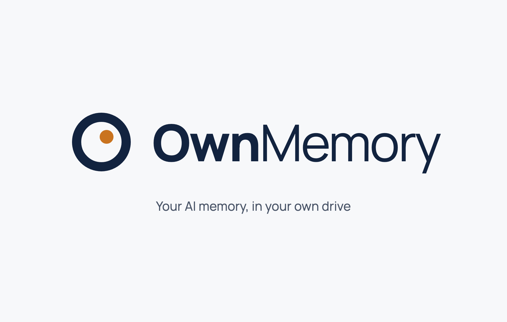
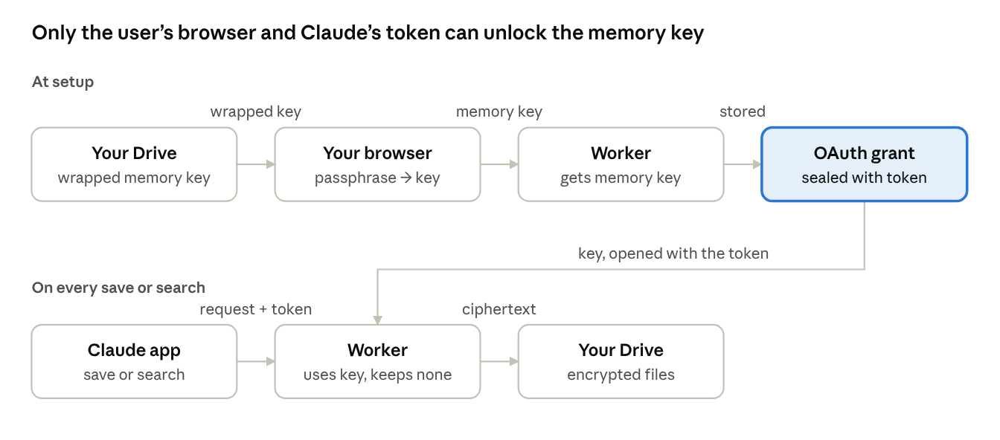

OwnMemory lets Claude remember you across chats and devices, with the memories stored encrypted under a key only you hold, in storage you own.

Claude calls a remote MCP server running in your own Cloudflare account. The server encrypts each memory and stores it in a D1 database in that account (the one-click default) or in an `OwnMemory` folder in your Google Drive. It works in the official Claude apps on the web, iPhone and Android.

**Get started:** click the button above, choose an owner code, then open your server's address and follow its four setup steps. About 5 minutes, on a free Cloudflare account. Full guide, including Google Drive storage: [docs/setup.md](docs/setup.md).

**Status:** early (v0.2). Works today with Claude on the web, iPhone and Android, and with MCP clients such as Claude Code, Cursor, Gemini CLI and Codex.

## How your memories stay yours

- **Your passphrase never leaves your browser.** When you connect Claude, the passphrase page turns it into a key that unlocks a random 256-bit memory key. Only the locked copy of that key is stored, in your storage (`keyinfo.json`).
- **Every memory is encrypted** (AES-256-GCM) before it is stored, in a file with a random name. Your storage provider and anyone with the files see only ciphertext.
- **The server keeps no key at rest.** The memory key and your Google token live only inside the OAuth grant, which is encrypted with Claude's access token. The MCP handler is stateless: nothing is written to Durable Objects or logs.
- **Hard rules in code.** Blocked categories, a pause switch, and a filter that refuses passwords, API keys and card numbers, whatever the AI decides.
- **Search by meaning, still private.** Embeddings come from Cloudflare Workers AI in your own account and are stored encrypted like the memories. Set the `SEMANTIC_SEARCH` secret to `off` to keep memory text away from it; search then uses keywords only.
- **See and fix what it remembers.** Your server's `/memories` page lets you browse, search, edit, add and delete memories, decrypted only in your browser.
- **No lock-in.** **Download all** on the memories page gives you every memory as Markdown, and [ownmemory.app/decrypt](https://ownmemory.app/decrypt) decrypts a downloaded copy in your browser, even without your server.

The one unavoidable exposure: the server and Anthropic see a memory's text while a save or search runs, because Claude sends plain text. Running the server yourself is the safeguard.

## Tools Claude gets

| Tool | What it does |
| --- | --- |
| `load_core_memories` | Called at the start of a chat: returns the memory mode, any message for you, and (in OwnMemory-only mode) your profile, preferences and recent work |
| `search_memories` | Search by meaning and keywords, English, Chinese or mixed (finds "What do I like to drink?" without shared words) |
| `list_memories` | Most recent memories, optionally by category |
| `save_memory` | Saves one fact, after the hard rules allow it; points out facts already saved, even when worded differently |
| `import_memories` | Saves up to 50 facts at once, for example everything Claude's built-in memory knows |
| `update_memory` | Changes a fact, keeping the previous wording as dated history |
| `delete_memory` | Deletes a memory; it stays 30 days in D1, or in the Drive trash |
| `review_memories` | Finds memories with the same wording or meaning, to merge |
| `set_memory_mode` | Records how you use OwnMemory alongside Claude's memory: ramp-up, OwnMemory only, or keep both |

## Repository layout

| Path | What's there |
| --- | --- |
| `server/src/` | The Cloudflare Worker: OAuth and sign-in flow (`auth.ts`), passkey and authenticator sign-in on one-click servers (`gate.ts`, `factors.ts`), the memories page's API (`memories.ts`), MCP tools (`tools.ts`), storage backends D1 and Drive (`storage.ts`, `google.ts`), encrypted memory store (`store.ts`), memory format, search and duplicate checks (`format.ts`), memory modes and ramp-up (`settings.ts`), pages (`pages.ts`) |
| `server/public/unlock.js`, `home.js`, `memories.js`, `gate.js` | Scripts for the passphrase page, the setup wizard, the memories page and the passkey / authenticator sign-in step |
| `server/public/keys.js`, `memory-file.js`, `zip.js` | Encryption, the memory file format and the zip builder, shared by the browser, the Worker, the decrypt tool and `site/public/decrypt.html` (copies; `npm run sync-site`), so the format can't drift |
| `site/` | The ownmemory.app landing page and [the decrypt page](https://ownmemory.app/decrypt): static files, no data collected |
| `server/scripts/decrypt.mjs` | Local export to plain Markdown |
| `server/test/` | Unit tests (`npm test`) and a recall evaluation against real embeddings (`npm run eval`) |
| `docs/` | Setup guide and the key-flow diagram |
| `design/logo/` | Logo sources from the design canvas and PNG/SVG exports |

## Contributing, security and license

- Contributions are welcome; see [CONTRIBUTING.md](CONTRIBUTING.md). Contributors sign a short [contributor license agreement](CLA.md).
- Found a security problem? Please report it privately: [SECURITY.md](SECURITY.md).
- Licensed under the [Apache License 2.0](LICENSE). "OwnMemory" and the OwnMemory logo are trademarks of the project and are not covered by the license; forks need a different name.
